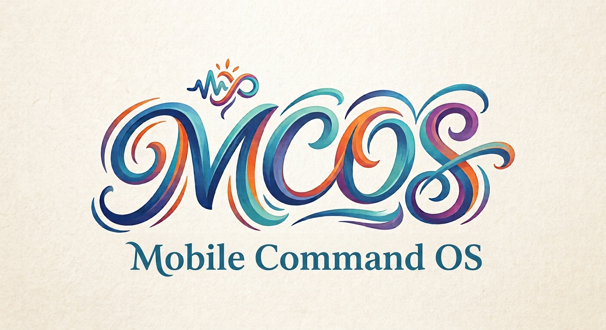
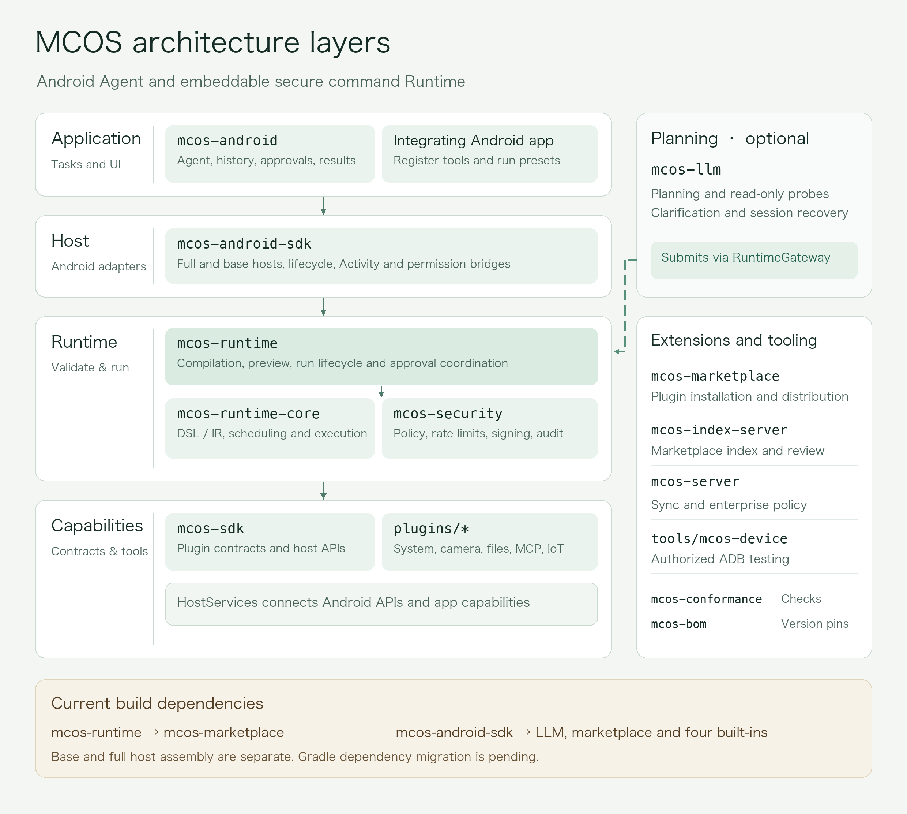

<div align="center">




# MCOS — Mobile Command OS

**An open-source Android task agent powered by an embeddable secure runtime.**

[](https://central.sonatype.com/artifact/io.github.morainet/mcos-bom/overview)
[](https://github.com/Morainet/mcos/actions/workflows/ci.yml)
[](https://github.com/Morainet/mcos/blob/main/LICENSE)
[](./CONTRIBUTING.md)

[](https://kotlinlang.org)
[](./mcos-android-sdk/README.md)
[](https://openjdk.org/projects/jdk/17/)
[](#build)
[](https://github.com/Morainet/mcos/commits/main)

[Quick Start](#quick-start) · [How It Works](#how-it-works) · [What's Inside](#whats-inside) · [Documentation](#documentation) · [Report a Bug](https://github.com/Morainet/mcos/issues) · [中文文档](./README.zh-CN.md)

*Give MCOS a goal on your phone. It uses available tools, asks for approval when needed, and reports what happened.*

[Current architecture and development boundaries](./docs/en/13-architecture-convergence.md)

</div>

---

## Table of Contents

- [Why MCOS](#why-mcos)
- [How It Works](#how-it-works)
- [Quick Start](#quick-start)
- [What's Inside](#whats-inside)
- [Documentation](#documentation)
- [Build](#build)
- [Release](#release)
- [License & Contributing](#license--contributing)

## Why MCOS

MCOS gives a phone-based Agent access to host-registered capabilities, with approvals, results, and audit for each task. Android developers can embed the same command Runtime in their own app.

## How It Works

Presets submit command requests directly. For natural language, a configured model plans from the available commands. The Runtime compiles the request and applies validation, permissions, and approval. Plugins handle the capabilities, and the app presents the result. See the [current architecture](./docs/en/13-architecture-convergence.md).

## Quick Start

Open the [MCOS Android app](./mcos-android/README.md), open the workspace menu in the upper-left corner of the conversation, and choose **Export the latest completed inspection**. The sample runs without a model. Open **Model settings** from the same menu to connect a model and submit your own tasks.

The App owns task submission, approval, and results. The developer-only [ADB host](./tools/mcos-device/README.md) can provide an inspection tool to the Agent on authorized debug devices.

### Android host app

```kotlin
// settings.gradle.kts
dependencyResolutionManagement {
    repositories {
        google()        // required by the Android SDK's androidx dependencies
        mavenCentral()
    }
}
```

```kotlin
// build.gradle.kts — consume via the BOM so every module stays version-aligned
dependencies {
    implementation(platform("io.github.morainet:mcos-bom:0.0.6"))
    implementation("io.github.morainet:mcos-android-sdk")
}
```

See the [Android SDK guide](./mcos-android-sdk/README.md#全量宿主接入) for the Application wiring. The host exposes its process-level assembly through `McosHostApp.mcosDeps` so SDK receivers can restore tasks.

### JVM host & plugin authors

```kotlin
dependencies {
    implementation(platform("io.github.morainet:mcos-bom:0.0.6"))
    implementation("io.github.morainet:mcos-runtime")  // JVM host (server / CLI / desktop)
    // implementation("io.github.morainet:mcos-sdk")   // plugin authors: contracts only
}
```

## What's Inside

- [`mcos-android`](./mcos-android/README.md) is the Android Agent app and the device debugging entry point.
- [`mcos-android-sdk`](./mcos-android-sdk/README.md) assembles the host. `mcos-runtime` and `mcos-runtime-core` manage execution, and `mcos-security` provides the security kernel.
- `mcos-sdk` defines the plugin contracts. Models, marketplace, sync, and device adapters have their own entry points.



See the [current architecture](./docs/en/13-architecture-convergence.md) for the full module table, current dependencies, and target architecture.

## Documentation

[English docs](./docs/en/README.md) · [中文文档](./docs/zh/README.md) · [Current implementation](./docs/en/11-implementation-status.md) · [Product direction](./docs/en/15-product-direction.md) · [Command fixtures](./docs/fixtures/README.md)

## Build

`gradlew` in this repo has no execute bit — invoke it through the shell:

```bash
sh gradlew build        # full gate (JVM + Android + tests)
sh gradlew :mcos-runtime-core:test    # Runtime core unit tests
sh gradlew :mcos-android:assembleDebug   # Android Agent Debug APK
```

## Release

Artifacts are published to Maven Central under `io.github.morainet` (namespace verified via the [Morainet](https://github.com/Morainet) GitHub org). Pushing a `v<version>` tag triggers the [release workflow](./.github/workflows/release.yml): build gate → GPG-signed publish → Central Portal upload → GitHub Release with the demo APK. Local dry-run: `sh gradlew publish` fills `build/central-bundle` (unsigned, no secrets needed).

## License & Contributing

[](./LICENSE)
[](./CONTRIBUTING.md)

[Apache License 2.0](./LICENSE) · [CONTRIBUTING.md](./CONTRIBUTING.md) · [CHANGELOG.md](./CHANGELOG.md)

---

<div align="center">

**中文说明：见 [README.zh-CN.md](./README.zh-CN.md)。**

⭐ Star the repo if MCOS sounds like the layer your AI app is missing.

</div>
