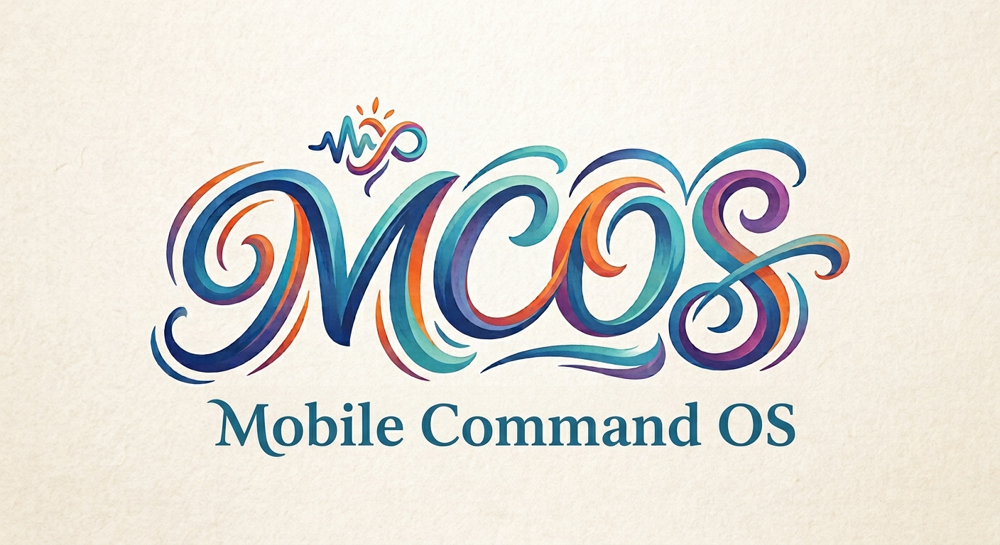
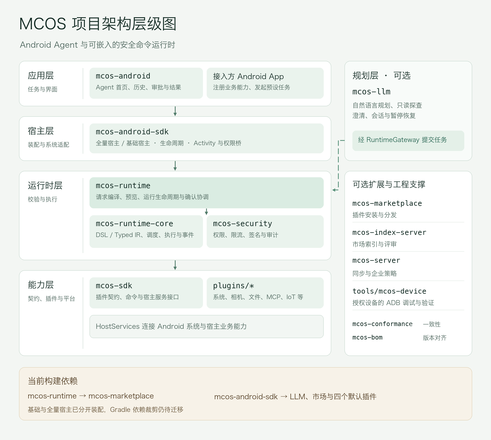

<div align="center">



# MCOS — 移动命令操作系统

**以可嵌入安全 Runtime 为底座的开源 Android Agent。**

[](https://central.sonatype.com/artifact/io.github.morainet/mcos-bom/overview)
[](https://github.com/Morainet/mcos/actions/workflows/ci.yml)
[](https://github.com/Morainet/mcos/blob/main/LICENSE)
[](./CONTRIBUTING.md)

[](https://kotlinlang.org)
[](./mcos-android-sdk/README.md)
[](https://openjdk.org/projects/jdk/17/)
[](#构建)
[](https://github.com/Morainet/mcos/commits/main)

[快速开始](#快速开始) · [运行原理](#运行原理) · [模块组成](#模块组成) · [文档导航](#文档导航) · [反馈问题](https://github.com/Morainet/mcos/issues) · [English](./README.md)

*在手机上交代目标，MCOS 调用可用工具，必要时请你确认，并返回执行结果。*

[近期架构与开发边界](./docs/zh/13-architecture-convergence.md)

</div>

---

## 目录

- [为什么是 MCOS](#为什么是-mcos)
- [运行原理](#运行原理)
- [快速开始](#快速开始)
- [模块组成](#模块组成)
- [文档导航](#文档导航)
- [构建](#构建)
- [发布](#发布)
- [贡献与许可](#贡献与许可)

## 为什么是 MCOS

MCOS 让手机上的 Agent 调用宿主注册的能力，并通过审批、结果和审计把任务闭环。Android 开发者也可以直接把同一套命令运行时嵌入自己的应用。

## 运行原理

预设任务直接发出命令请求。自然语言任务由配置好的模型从可用命令中规划。Runtime 编译请求并执行校验、权限和确认，插件处理具体能力，App 展示结果。详见[当前架构](./docs/zh/13-architecture-convergence.md)。

## 快速开始

打开 [MCOS Android App](./mcos-android/README.md)，在对话页左上角打开工作区菜单，选择 **Export the latest completed inspection**。示例可直接在手机上完成，也可以从菜单进入 **Model settings**，连接模型后输入自己的任务。

任务提交、审批和结果都在 App 内完成。开发者可在授权的调试设备上连接 [ADB 宿主](./tools/mcos-device/README.md)，由 Agent 调用设备观察工具。

### Android 宿主 App

```kotlin
// settings.gradle.kts
dependencyResolutionManagement {
    repositories {
        google()   // mcos-android-sdk 依赖 androidx，必须声明
        mavenCentral()
    }
}
```

```kotlin
// build.gradle.kts —— 推荐走 BOM，保证各模块版本对齐
dependencies {
    implementation(platform("io.github.morainet:mcos-bom:0.0.6"))
    implementation("io.github.morainet:mcos-android-sdk")
}
```

完整 Application 接线见 [Android SDK](./mcos-android-sdk/README.md#全量宿主接入)。宿主通过 `McosHostApp.mcosDeps` 暴露进程级装配，供 SDK 接收器恢复任务。

### JVM 宿主与插件作者

```kotlin
dependencies {
    implementation(platform("io.github.morainet:mcos-bom:0.0.6"))
    implementation("io.github.morainet:mcos-runtime")   // JVM 宿主（服务端 / CLI / 桌面）
    // implementation("io.github.morainet:mcos-sdk")    // 插件作者：仅需契约层
}
```

## 模块组成

- [`mcos-android`](./mcos-android/README.md) 是 Android Agent App，也是手机端调试入口。
- [`mcos-android-sdk`](./mcos-android-sdk/README.md) 提供宿主装配，`mcos-runtime` 与 `mcos-runtime-core` 管理执行，`mcos-security` 提供安全内核。
- `mcos-sdk` 提供插件契约。`mcos-llm`、市场、同步和设备适配各有自己的入口。



完整模块表、当前依赖和目标依赖见[当前架构](./docs/zh/13-architecture-convergence.md)。

## 文档导航

[中文文档](./docs/zh/README.md) · [English docs](./docs/en/README.md) · [当前实现](./docs/zh/11-implementation-status.md) · [产品方向](./docs/zh/15-product-direction.md) · [命令用例](./docs/fixtures/README.md)

## 构建

本仓库 `gradlew` 无执行位，统一用 `sh gradlew`：

```bash
sh gradlew build                 # 全量门禁（JVM + Android + 测试）
sh gradlew :mcos-runtime-core:test   # 运行时内核单测
sh gradlew :mcos-android:assembleDebug   # Android Agent Debug APK
```

## 发布

制品发布到 Maven Central，坐标 `io.github.morainet`（通过 [Morainet](https://github.com/Morainet) GitHub 组织验证）。推送 `v<版本>` 标签即触发 [release workflow](./.github/workflows/release.yml)：构建门禁 → GPG 签名发布 → Central Portal 上传 → 附演示 APK 的 GitHub Release。本地演练：`sh gradlew publish` 填充 `build/central-bundle`（无签名、无需密钥）。

## 贡献与许可

[](./LICENSE)
[](./CONTRIBUTING.md)

[Apache License 2.0](./LICENSE) · [CONTRIBUTING.md](./CONTRIBUTING.md) · [CHANGELOG.md](./CHANGELOG.md)

---

<div align="center">

[English](./README.md) · **中文**

⭐ 如果 MCOS 正是你的 AI 应用缺的那一层，欢迎点个 Star。

</div>
