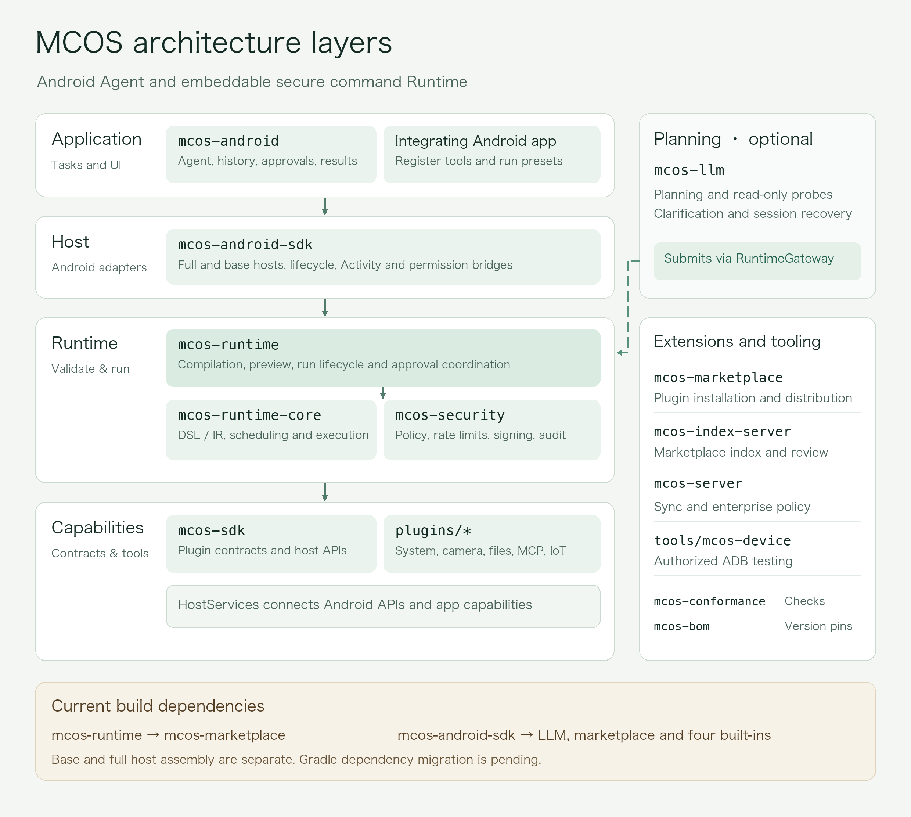

# Current architecture and development boundaries

[中文](../zh/13-architecture-convergence.md) · [Documentation index](./README.md)

MCOS provides a secure command runtime embeddable in Android apps and an open-source Android Agent for phone tasks. Hosts register capabilities, the Agent plans from goals, and the Runtime validates, authorizes, confirms, schedules, and executes requests. Preset tasks can enter the Runtime directly.



## Where to make changes

| Area | Entry point |
|---|---|
| Agent home, splash screen, task history, progress, and approval UI | [`mcos-android`](../../mcos-android/README.md) |
| Natural-language planning, read-only probes, clarification, and suspended sessions | `LlmPlanner`, `McosAgent`, and `AgentSessionStore` in [`mcos-llm`](../../mcos-llm/README.md) |
| Preview, run lifecycle, cancellation, and approval coordination | `McosRuntime`, `RuntimeRequestCompiler`, and `ConfirmationCoordinator` in [`mcos-runtime`](../../mcos-runtime/README.md) |
| DSL, typed IR, registration, execution, scheduling, workflows, events, and memory | [`mcos-runtime-core`](../../mcos-runtime-core/README.md) |
| Permissions, signing, rate limits, egress, schema validation, and audit | [`mcos-security`](../../mcos-security/README.md) |
| Plugin manifests, command handlers, and host interfaces | [`mcos-sdk`](../../mcos-sdk/README.md) and [`plugins/`](../../plugins/) |
| Android capabilities, Activity bridges, assembly, and background recovery | [`mcos-android-sdk`](../../mcos-android-sdk/README.md) |
| ADB debugging and export verification | [`tools/mcos-device`](../../tools/mcos-device/README.md) and the [`mcos-android` Debug regression screen](./14-embedded-host.md) |
| Installation, indexing, sync, and conformance | [`mcos-marketplace`](../../mcos-marketplace/README.md), [`mcos-index-server`](./12-index-server.md), [`mcos-server`](../../mcos-server/README.md), and `mcos-conformance` |

## Execution flow

```text
Android Agent home ── optional model planning ──┐
Android host / preset task / DSL ───────────────┴─→ McosRuntime
  → RuntimeRequestCompiler → scheduling → validation, policy, and confirmation → plugin / HostServices
  → run events, artifacts, terminal status, and audit → caller
```

`McosRuntime.preview()` and `execute()` share `RuntimeRequestCompiler` for DSL, IR JSON, and named workflows. Preview parses and checks the request. `McosRuntime` manages the run lifecycle and confirmation. The executor checks policy before invoking a plugin handler. The LLM resolves commands through the core `RuntimeGateway`, and the app owns assembly and presentation.

## Android host entry points

| Entry | Purpose |
|---|---|
| `CompositionRoot.create` + `RuntimeBootstrap.ensureRehydrated` | Full Android host used by [`McosApplication`](../../mcos-android/src/main/kotlin/com/morainet/mcos/android/demo/McosApplication.kt). Provides default plugins, Android interaction bridges, durable schedule recovery, and opt-in process isolation. |
| Suspend `CompositionRoot.createEmbedded(context, plugins)` | Base assembly for trusted app-shipped capabilities. Registers the host plugins and provides Runtime policy, confirmation, and local audit. The host can opt into model planning, marketplace assembly, background wake-ups, and Activity interaction separately. |

One `mcos-android` Debug APK has two entry points. `MainActivity` is the user-facing Agent home. Its preset queries the latest completed inspection, asks for approval, and verifies the actual file. `RecordExportActivity` is the Debug-only regression screen for host integration and ADB. `RecordDebugHost` gives it a separate embedded Runtime. The [device guide](../../tools/mcos-device/README.md) covers the ADB prototype and the model-backed CLI with their validation evidence.

## Current Gradle dependencies

The table lists the main direct project dependencies. The four Android SDK default plugins are `hello`, `system`, `camera`, and `files`. See each `build.gradle.kts` for dependency scope and [`settings.gradle.kts`](../../settings.gradle.kts) for included modules.

| Module | Direct project dependencies |
|---|---|
| `mcos-sdk` | None |
| `mcos-security` | `mcos-sdk` |
| `mcos-runtime-core` | `mcos-sdk`, `mcos-security` |
| `mcos-llm` | `mcos-sdk`, `mcos-runtime-core`. Tests also use `mcos-runtime`. |
| `mcos-marketplace` | `mcos-sdk`, `mcos-security`, `mcos-runtime-core` |
| `mcos-runtime` | `mcos-sdk`, `mcos-security`, `mcos-runtime-core`, `mcos-marketplace` |
| `mcos-android-sdk` | All six libraries above and the four default plugins. `androidTest` also uses `mcos-plugin-devicefixture`. |
| `mcos-android` | `mcos-android-sdk`, all six libraries above, and `mcos-plugin-mcp`. Tests also use the four default plugins. |
| `plugins:mcos-plugin-*` | Each plugin depends on `mcos-sdk`. Hosts opt into MCP, IoT, and Intent. `devicefixture` supports tests. |
| `mcos-server` | `mcos-security`. Tests also use `mcos-runtime-core`. |
| `mcos-index-server`, `mcos-conformance` | `mcos-marketplace`, `mcos-security`, `mcos-runtime-core`, `mcos-sdk` |
| `mcos-bom` | Java Platform with version constraints for [published modules](../../mcos-bom/build.gradle.kts). |

Base and full host assemblies share the current Android SDK artifact. Removing the facade's marketplace edge and the Android SDK's extension dependencies requires future compatibility work. The `:mcos_plugin` process runs under the same UID when enabled. See the [SDK guide](../../mcos-android-sdk/README.md) for its isolation scope.

## Target architecture and migration

This dependency layout is the design direction. The preceding table records the dependencies in the current build.

```text
mcos-android / integrating app
  ├─ mcos-android-sdk → mcos-runtime → mcos-runtime-core → mcos-security / mcos-sdk
  ├─ optional mcos-llm → RuntimeGateway
  ├─ host-selected plugins → mcos-sdk
  └─ optional marketplace, MCP, sync, and device adapters
```

- **Keep one execution path.** Tie validation, registration, permission, confirmation, cancellation, and audit to the run. Model plans, presets, and Debug regression tests use the same authorization and execution contracts.
- **Let the host assemble capabilities.** The Android SDK provides platform services, lifecycle integration, and permission bridges. Apps select models, extra plugins, and remote services. Keep a shared registry, permission kernel, signer, and grant table within each host. The app and Debug regression screen can assemble separate hosts.
- **Keep product state in the app.** Extract task execution, history, model settings, and capability management from `McosViewModel` by use case. Compose observes state and emits UI events. ADB stays in developer tooling or an explicitly enabled device adapter wired through Runtime approval and result verification.

| Order | Change | Acceptance |
|---|---|---|
| 1 | Establish baselines for the `mcos-android` Agent home and the Debug regression screen in the same APK. | Exercise both paths and tie run ID, approval, exported file, and audit together. Cover rejection, cancellation, and failure. |
| 2 | Separate app state and host assembly using `EmbeddedRuntime`, `RuntimeGateway`, and the existing permission components. | Presets run offline. Task switching and restart retain history semantics, and the full host still restores plugins and schedules. |
| 3 | Move cross-boundary types and assembly before tightening Gradle dependencies. Review public signatures including `McosRuntime.Builder.withPluginInstaller`, `pluginInstaller()`, and `AppDeps`. | Document host migration and verify a base-host build. Preserve DSL/IR fixtures, conformance, API compatibility, and the Android build. |

## Verification and references

- The [contributing guide](../../CONTRIBUTING.md) covers environment setup and build commands. Check command and security behavior against the protocol, source, and tests.
- See [implementation status](./11-implementation-status.md) for coverage and [product direction](./15-product-direction.md) for priorities.
- See the [historical architecture draft](./01-architecture.md) and [historical roadmap](./10-roadmap.md) for the original IPC sketches and P0–P4 plans.
