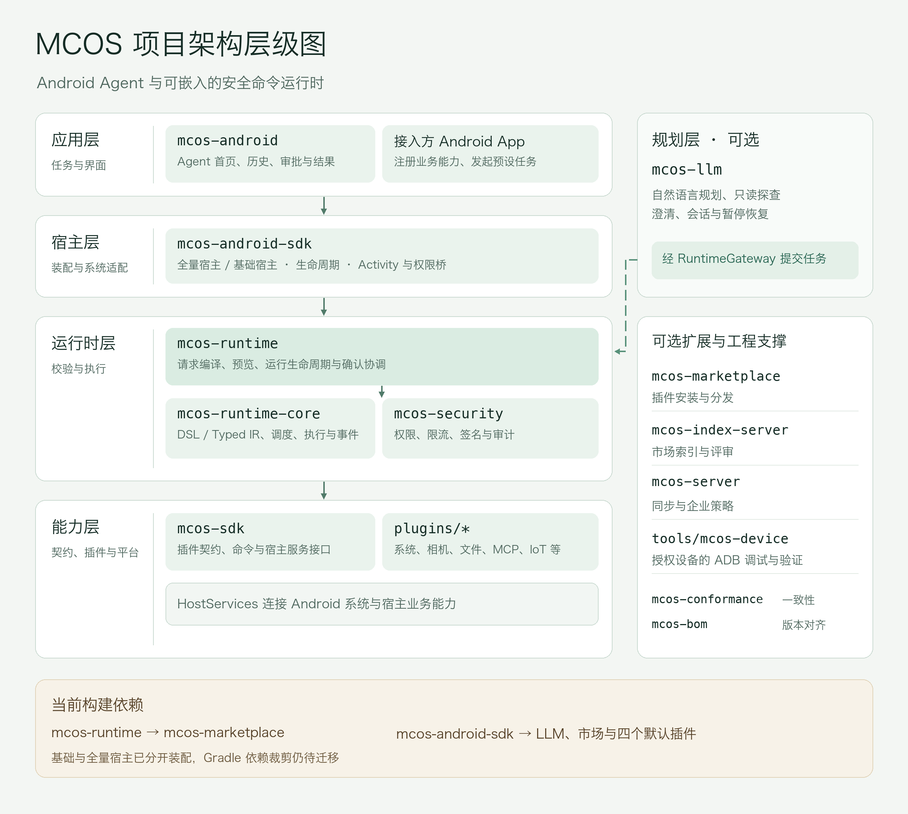

# 当前架构与开发边界

[English](../en/13-architecture-convergence.md) · [文档索引](./README.md)

MCOS 提供可嵌入 Android 应用的安全命令运行时，以及一个面向手机任务的开源 Android Agent。宿主注册自己的能力，Agent 根据目标规划，Runtime 处理校验、权限、确认、调度与执行。预设任务可以直接进入 Runtime。



## 需求从哪里改

| 需求 | 入口 |
|---|---|
| Agent 首页、启动页、任务历史、进度和审批交互 | [`mcos-android`](../../mcos-android/README.md) |
| 自然语言规划、只读探查、澄清和暂停恢复 | [`mcos-llm`](../../mcos-llm/README.md) 的 `LlmPlanner`、`McosAgent`、`AgentSessionStore` |
| 请求预览、运行生命周期、取消、确认协调 | [`mcos-runtime`](../../mcos-runtime/README.md) 的 `McosRuntime`、`RuntimeRequestCompiler`、`ConfirmationCoordinator` |
| DSL、Typed IR、注册、执行、调度、工作流、事件、记忆 | [`mcos-runtime-core`](../../mcos-runtime-core/README.md) |
| 权限、签名、限流、出网、Schema 校验、审计 | [`mcos-security`](../../mcos-security/README.md) |
| 插件清单、命令处理器、宿主能力接口 | [`mcos-sdk`](../../mcos-sdk/README.md) 和 [`plugins/`](../../plugins/) |
| Android 系统能力、Activity 桥、App 装配、后台恢复 | [`mcos-android-sdk`](../../mcos-android-sdk/README.md) |
| ADB 设备调试与导出验证 | [`tools/mcos-device`](../../tools/mcos-device/README.md) 和 [`mcos-android` Debug 回归页](./14-embedded-host.md) |
| 安装、索引、同步、制品一致性 | [`mcos-marketplace`](../../mcos-marketplace/README.md)、[`mcos-index-server`](./12-index-server.md)、[`mcos-server`](../../mcos-server/README.md)、`mcos-conformance` |

## 运行链路

```text
Android Agent 首页 ── 可选的模型规划 ──┐
Android 宿主 / 预设任务 / DSL ─────────┴─→ McosRuntime
  → RuntimeRequestCompiler → 调度 → 内核校验、权限与确认 → 插件 / HostServices
  → 运行事件、产物、终态和审计 → 调用方
```

`McosRuntime.preview()` 和 `execute()` 共用 `RuntimeRequestCompiler` 处理 DSL、IR JSON 和命名工作流。预览只解析和检查请求。`McosRuntime` 管理运行生命周期和确认，内核执行器在调用插件处理器前完成对应的策略检查。LLM 使用内核 `RuntimeGateway`，应用负责装配并展示结果。

## Android 的两个装配入口

| 入口 | 用途 |
|---|---|
| `CompositionRoot.create` + `RuntimeBootstrap.ensureRehydrated` | 全量 Android 宿主，供 [`McosApplication`](../../mcos-android/src/main/kotlin/com/morainet/mcos/android/demo/McosApplication.kt) 使用。带默认插件、Android 交互桥、持久调度恢复和可选进程隔离。 |
| suspend `CompositionRoot.createEmbedded(context, plugins)` | 接入随 App 发布的可信能力。基础装配注册宿主插件，保留 Runtime 权限与审批，提供本地审计。模型、市场装配、后台唤醒和 Activity 交互桥由宿主按需求另行接入。 |

在 `mcos-android` 的同一个 Debug APK 中可以打开两个页面。`MainActivity` 是用户的 Agent 首页，内置巡检任务会查询最新已完成记录、请求审批并核验实际文件。`RecordExportActivity` 是专门给宿主接入和 ADB 回归用的 Debug 页面，由 `RecordDebugHost` 装配独立的基础 Runtime。ADB 原型和实时模型 CLI 的操作与核验证据见 [设备调试文档](../../tools/mcos-device/README.md)。

## 当前 Gradle 依赖

下表记录主要的直接项目依赖。Android SDK 的默认插件是 `hello`、`system`、`camera`、`files`。这里的直接边以各模块的 `build.gradle.kts` 为准，模块列表以 [`settings.gradle.kts`](../../settings.gradle.kts) 为准。

| 模块 | 直接项目依赖 |
|---|---|
| `mcos-sdk` | 无 |
| `mcos-security` | `mcos-sdk` |
| `mcos-runtime-core` | `mcos-sdk`、`mcos-security` |
| `mcos-llm` | `mcos-sdk`、`mcos-runtime-core`；测试依赖 `mcos-runtime` |
| `mcos-marketplace` | `mcos-sdk`、`mcos-security`、`mcos-runtime-core` |
| `mcos-runtime` | `mcos-sdk`、`mcos-security`、`mcos-runtime-core`、`mcos-marketplace` |
| `mcos-android-sdk` | 上述六个库和四个默认插件；`androidTest` 依赖 `mcos-plugin-devicefixture` |
| `mcos-android` | `mcos-android-sdk`、上述六个库和 `mcos-plugin-mcp`；测试使用四个默认插件 |
| `plugins:mcos-plugin-*` | 每个插件依赖 `mcos-sdk`。MCP、IoT、Intent 由宿主显式装配，`devicefixture` 用于测试。 |
| `mcos-server` | `mcos-security`；测试依赖 `mcos-runtime-core` |
| `mcos-index-server`、`mcos-conformance` | `mcos-marketplace`、`mcos-security`、`mcos-runtime-core`、`mcos-sdk` |
| `mcos-bom` | Java Platform，约束已发布模块版本，配置见 [BOM](../../mcos-bom/build.gradle.kts)。 |

基础宿主与全量宿主已经分开装配，仍使用同一个 Android SDK 制品。裁剪运行时门面的市场依赖和 Android SDK 的扩展依赖属于后续兼容迁移。`:mcos_plugin` 是选择启用的同 UID 插件进程，隔离范围见 [SDK 指南](../../mcos-android-sdk/README.md)。

## 目标架构与迁移顺序

目标依赖按宿主分层。以下是设计方向，已生效的依赖以上表为准。

```text
mcos-android / 接入方 App
  ├─ mcos-android-sdk → mcos-runtime → mcos-runtime-core → mcos-security / mcos-sdk
  ├─ 可选 mcos-llm → RuntimeGateway
  ├─ 宿主选择的插件 → mcos-sdk
  └─ 可选 Marketplace、MCP、同步和设备适配
```

- **Runtime 保持统一执行。** 运行 ID、命令注册、权限、确认、取消与审计由同一次运行关联。LLM、预设与 Debug 回归走同一授权和执行契约。
- **宿主负责装配。** Android SDK 提供 Android 服务、生命周期与授权桥。应用选择模型、额外插件和远端服务。每个宿主内的注册中心、权限内核、签名器与授权表应继续共享，App 和 Debug 回归可各自装配。
- **App 负责产品状态。** 将任务执行、历史、模型配置、能力管理按用例从 `McosViewModel` 逐步提取。Compose 订阅状态与发出事件。ADB 留在开发者工具或明确启用的设备适配，沿 Runtime 确认与验证路径接线。

| 顺序 | 改动 | 验收 |
|---|---|---|
| 1 | 固定两条基准链路，利用 `mcos-android` 的 Agent 首页和同包 Debug 回归页。 | 两条链路分别可跑通，能够关联 runId、审批结果、实际文件和审计。拒绝、取消及失败有对应回归。 |
| 2 | 先收敛 App 状态与宿主装配，复用 `EmbeddedRuntime`、`RuntimeGateway` 和现有权限组件。 | 预设可离线运行，切换任务和重启的历史语义稳定。全量宿主仍可恢复插件与调度。 |
| 3 | 迁出横跨边界的类型和装配逻辑，再约束 Gradle 依赖。优先审查 `McosRuntime.Builder.withPluginInstaller`、`pluginInstaller()`、`AppDeps` 等公开签名。 | 提供旧宿主迁移说明和基础宿主构建验证。DSL/IR fixture、一致性门、公开 API 与 Android 构建通过。 |

## 开发验证

- 模块、环境和验证命令见 [贡献指南](../../CONTRIBUTING.md)。命令、权限和行为变更以协议、源码与测试为依据。
- 入口和覆盖范围见 [当前实现](./11-implementation-status.md)，阶段取舍见 [产品方向](./15-product-direction.md)。
- 早期的分层、IPC 草案和 P0–P4 规划见 [架构设计参考](./01-architecture.md)与[历史路线图](./10-roadmap.md)。
